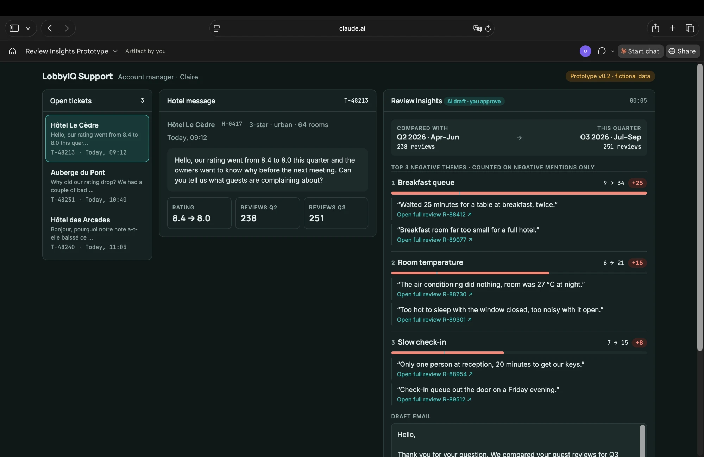

# 03 — Prototype link · Review Insights

- **Link:** https://claude.ai/artifact/ACcnJQciufTnteBCvRhPTE
- **Tool:** Claude artifact — source code in `03_prototype.html` (open it in a browser, edit it, republish)
- **Version:** v0.1 — draft panel for the usability test (Hotel Le Cèdre) → v0.2 — both quarters labelled at the top, every quote opens its full review
- **The prompt we used (the brief in three paragraphs):**

```
Paragraph 1 — who uses it and for what job:
Claire is an account manager at LobbyIQ, a reviews platform for hotels. A hotel asks "why did my rating drop?". She needs a one-page answer she can check and send within 24 h.

Paragraph 2 — what is on the screen (panels, buttons, the one thing it must never do):
A sidebar next to the hotel's ticket: the two quarters compared, the top 3 negative themes with their counts and change vs last quarter, two quotes per theme, and the draft email. Buttons: Approve, Edit, Write it myself. It must never send anything to the hotel by itself.

Paragraph 3 — the rules (routing, what is "human only", the trust level):
Fewer than 50 reviews, mostly non-English reviews or an off-topic ticket → no draft, a banner shows the reason and the ticket goes to Claire. No guest or staff name, no other hotel's data. Trust level L2: the AI drafts, Claire approves; sending is person only.
```

- **Screenshot:** 
